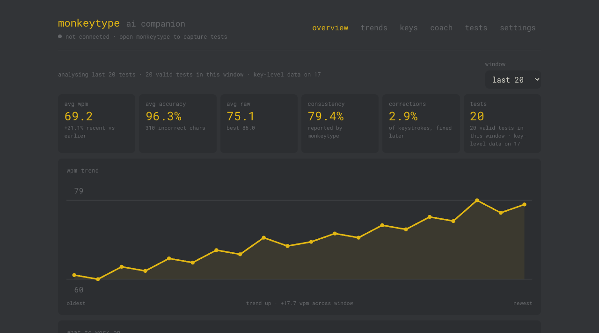
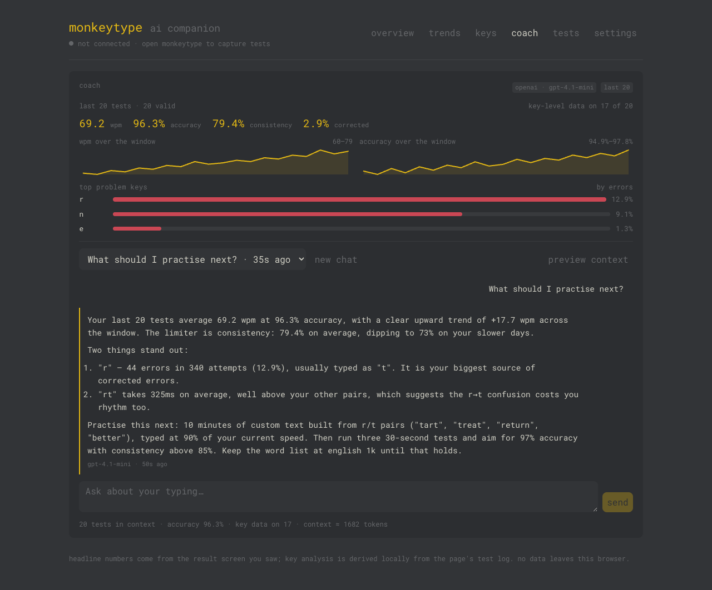
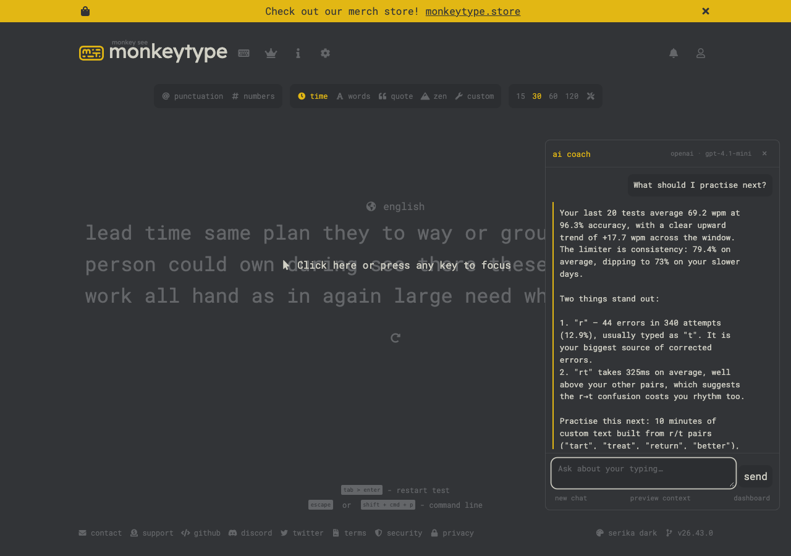
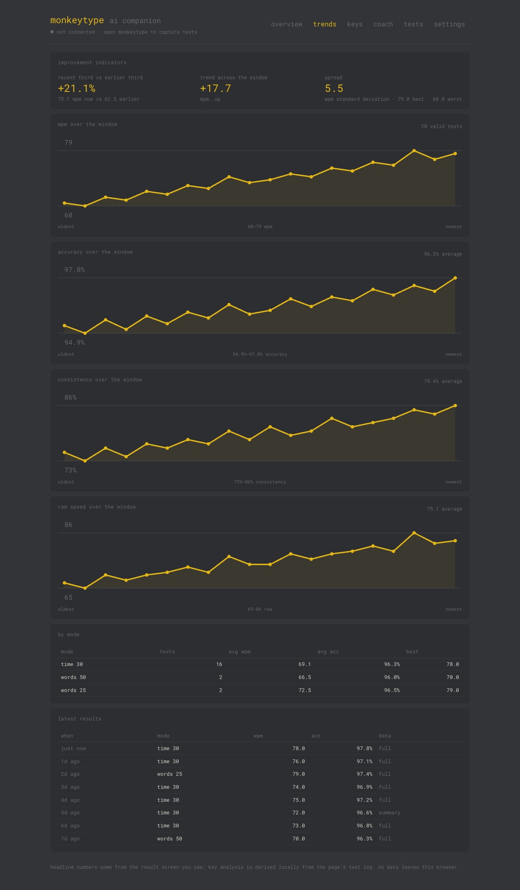
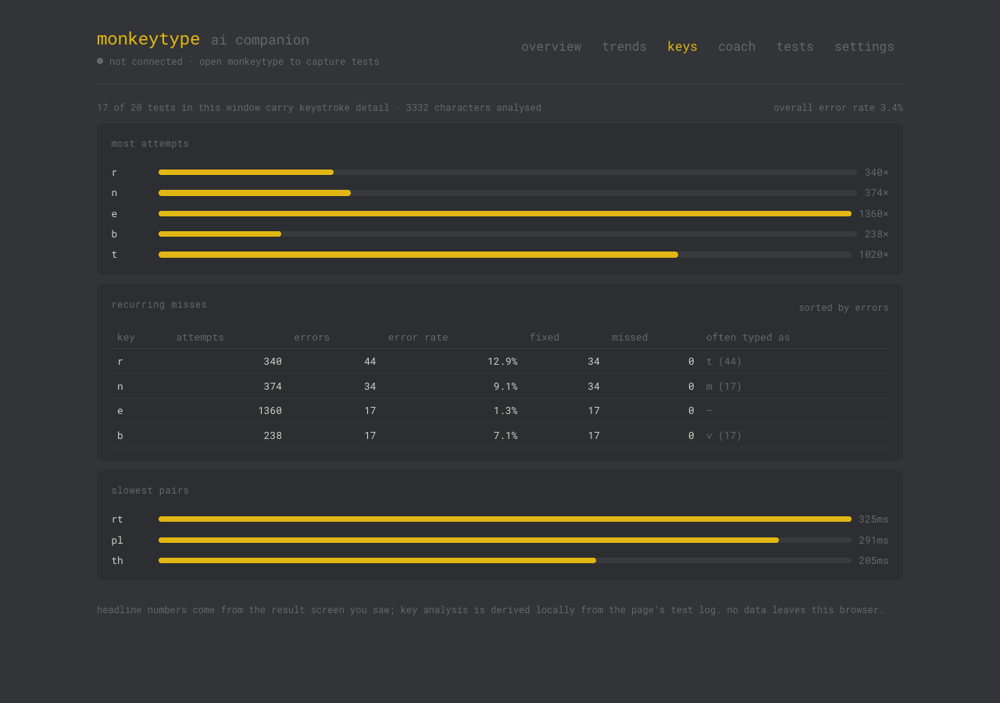
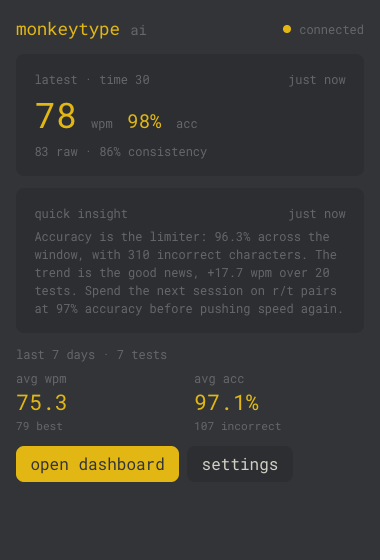

# Monkeytype AI Companion

A Chrome extension that turns [Monkeytype](https://monkeytype.com) into a personalised
typing coach: it captures your real test results, analyses them locally, and lets your
own AI model coach you from that data.

**Your typing data. Your AI provider. Your personal typing coach.**

[](https://developer.chrome.com/docs/extensions/develop/migrate)
[](https://www.typescriptlang.org/)
[](LICENSE)



<sub>Screenshots use a seeded demo profile. No real account data, and no API calls are made to produce them.</sub>

## Why

Monkeytype is excellent at showing you _what_ you typed. It does not tell you _why_
you are stuck: which keys you keep missing, whether speed is costing you accuracy,
or what to practise next.

This extension reads the data Monkeytype already produces, computes the statistics
itself, and only then asks a model — yours, with your key — to interpret them. The
model never does arithmetic, and it never sees anything except the summary you can
preview.

## Features

- **Captures real tests, automatically.** One record per completed test, including
  per-keystroke error data from the page's in-memory test log.
- **Local analytics.** Averages, trends, personal bests, error rates, confusion
  pairs, corrections, missed characters and typing rhythm — computed in the
  extension, deterministically, with tests.
- **Evidence-based weaknesses.** Every finding carries the numbers behind it and a
  concrete drill. With too little data it says so instead of guessing.
- **Bring your own model.** OpenAI, Anthropic Claude, Google Gemini, OpenRouter and
  any OpenAI-compatible endpoint, through the [Vercel AI SDK](https://ai-sdk.dev).
  Streaming, model discovery, connection test, normalised errors.
- **Two chat surfaces.** A coach tab in the dashboard and a chat button on the
  Monkeytype page itself that inherits the site's own styles.
- **Privacy by construction.** The exact prompt is previewable before sending, key
  data and recent-test summaries are optional, credentials never enter a content
  script, and no telemetry is sent anywhere.
- **Looks native.** Theme colours and roundness are sampled from your Monkeytype tab,
  so the extension matches whatever theme you use.
- **History import.** Pull older results with a Monkeytype ApeKey, clearly marked as
  headline-only data.

## Screenshots

|                                                   |                                                     |
| ------------------------------------------------- | --------------------------------------------------- |
|  |  |
| Coach grounded in your own numbers                | The same coach on monkeytype.com                    |
|   |         |
| Trends, comparisons and spread                    | Per-key error rates and slow pairs                  |



## Install

### From a release

1. Download the latest `monkeytype-ai-companion-*-chrome.zip` from Releases (created
   automatically when a `v*` tag is pushed).
2. Unzip it somewhere permanent.
3. Open `chrome://extensions`, enable **Developer mode**, click **Load unpacked** and
   select the unzipped folder.

The dashboard opens on install. Complete a test on monkeytype.com and it appears
within a few seconds.

### From source

```bash
bun install
cd apps/extension
bun run build     # production build
# or: bun run dev # rebuild on save
```

Load `apps/extension/.output/chrome-mv3` as an unpacked extension. Chrome 111+ is
required to run it; building requires Bun 1.4+.

## Connect a model

1. **Settings → ai provider**, pick a provider.
2. Paste your API key and **save key**. It is stored in `chrome.storage.local` and read
   only by extension pages and the service worker.
3. **load models** (or type a model id) and press **test connection**.
4. Ask something in the **coach** tab or from the panel on Monkeytype.

Provider setup, model discovery, browser-access notes and error handling are in
[docs/providers.md](docs/providers.md). No provider is required for the analytics.

## How it works

```
monkeytype.com
  ├─ main-world script   reads window.lastEventLog() and the live config
  ├─ isolated script     validates, derives per-key stats, sends one message per test
  └─ service worker      validates again, stores in IndexedDB, serves the in-page chat
                              │
                    dashboard / popup / coach read the same store
                              │
                    your provider (only the previewed context)
```

Two decisions drive the architecture:

1. **Headline numbers come from the results screen you saw**, so WPM, accuracy,
   consistency and character counts match Monkeytype exactly. Key-level analysis is
   derived locally from the event log.
2. **The AI never computes.** A deterministic context builder turns the captured tests
   into a compact summary; the model's job is interpretation. The same builder powers
   the "preview context" dialog.

## Project structure

```
apps/extension/
  src/entrypoints/     background, content, main-world bridge, popup, dashboard, options
  src/monkeytype/      page bridge, event-log schema, key derivation, result parsing,
                       history import
  src/analytics/       statistics, per-character analysis, weakness rules
  src/ai/              providers, model discovery, context, prompts, chat service
  src/storage/         IndexedDB repositories, settings, credentials
  src/ui/              React dashboard and popup (plain CSS, Monkeytype tokens)
  src/styles/base.css  token-parity stylesheet
  tests/               55 unit and DOM tests, including a real captured event log
  scripts/             headless verification and screenshot tooling
docs/
  design-system.md     tokens, component behaviour, licensing notes
  install.md           build and load instructions
  providers.md         provider setup, model discovery, error handling
  privacy.md           what is stored, what is sent, permissions
  limitations.md       every known limit and why it exists
```

## Development

| Command                                    | Purpose                                                 |
| ------------------------------------------ | ------------------------------------------------------- |
| `bun run dev`                              | WXT dev build for Chrome                                |
| `bun run build`                            | production build to `apps/extension/.output/chrome-mv3` |
| `bun run zip`                              | store-ready zip                                         |
| `bun run test`                             | Vitest suite                                            |
| `bun run check-types`                      | `wxt prepare` + `tsc --noEmit`                          |
| `bun run check`                            | Biome format + lint with fixes                          |
| `cd apps/extension && bun run verify:live` | headless Chrome, real Monkeytype capture                |
| `cd apps/extension && bun run verify:ai`   | headless chat and history import against local mocks    |
| `cd apps/extension && bun run screenshots` | regenerate the images in this README                    |

`verify:live` finishes an actual test on monkeytype.com headlessly and reads the record
back from IndexedDB. `verify:ai` starts a local OpenAI-compatible mock and a stubbed
Monkeytype API, then exercises both chat surfaces and the importer with no keys.

## Privacy

- Only `monkeytype.com` is in `host_permissions`; AI provider domains are optional,
  per-provider permissions requested when you configure one.
- Captured tests, conversations and settings stay in this browser profile.
- Sent to a provider: only the analysis summary plus your messages. Never test text,
  your account, browsing history, or record ids.
- API keys are never injected into the page. Chrome storage is not encrypted at rest
  beyond your OS disk encryption, and the UI says so.

Full detail: [docs/privacy.md](docs/privacy.md).

## Known limitations

- History exists only for tests captured while installed; ApeKey import is
  headline-only because Monkeytype's API has no keystroke data.
- Key-level analysis depends on `window.lastEventLog()`, an undocumented debugging
  global. It is feature-detected and validated; without it captures fall back to
  `summary` fidelity and the UI reports it.
- Only Chrome/Chromium 111+ is targeted.
- Fonts other than the bundled Roboto Mono are not shipped, so the extension keeps
  Roboto Mono even if your Monkeytype font differs.

The full list, with reasons, is in [docs/limitations.md](docs/limitations.md).

## Contributing

Issues and pull requests are welcome. Please keep the house rules:

- TypeScript strict mode, plain CSS (no Tailwind, no component library), Biome for
  formatting and linting.
- Never invent statistics. If the data cannot support a claim, say so.
- Keep credentials and network calls out of content scripts.
- Run `bun run test` and `bun run check` before opening a PR, and describe any manual
  check on the real site.

Conventional commits are appreciated.

## License

[MIT](LICENSE) © Sahil Verma.

This is an unofficial companion and is not affiliated with or endorsed by Monkeytype.
Monkeytype itself is GPL-3.0; this project contains no Monkeytype source code. Design
values and component behaviour are mirrored, and the in-page panel uses the site's own
loaded CSS at runtime. See [THIRD_PARTY_NOTICES.md](THIRD_PARTY_NOTICES.md).
